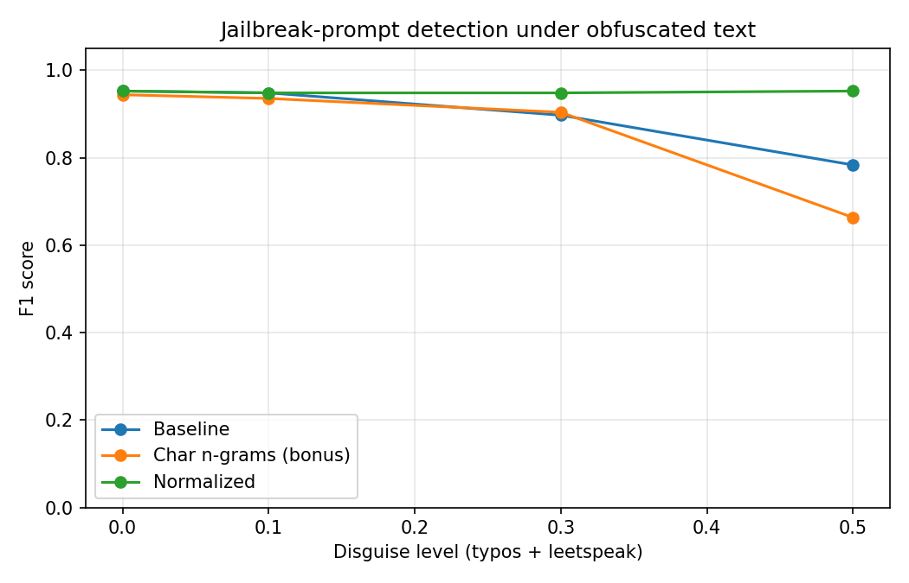

# Robustness of a Jailbreak-Prompt Detector to Obfuscated Text

## Goal
Measure how much typos and leetspeak (e.g. `ignore` -> `1gn0r3`) reduce the accuracy of a classifier that detects jailbreak prompts, and test whether lexical normalization recovers the loss. The normalization idea is inspired by my PACIS 2018 work on Roman Urdu text.

## Data
Public dataset: `jackhhao/jailbreak-classification` (Hugging Face), licensed under Apache-2.0. The dataset card has no detailed documentation, so the data is described from the data itself.

After removing duplicates: [N] English prompts ([X] jailbreak, [Y] benign). 80/20 stratified train/test split, random seed 42.

## Method
- **Models:** TF-IDF + logistic regression. *Baseline* (word n-grams), *Normalized* (same model, normalization applied to train and test text), *Char n-grams* (bonus).
- **Obfuscation:** random typos (swap, delete or duplicate a letter) and leetspeak (a->4, e->3, i->1, o->0, s->5, t->7). The *disguise level* is the probability that each eligible word gets a typo and each eligible letter is replaced. Levels tested: 0, 0.1, 0.3, 0.5.
- **Normalization:** lowercase, map digits and symbols back to letters, collapse repeated characters.
- **Metrics:** precision, recall, F1 (all saved in `results.csv`; the table below shows F1).

## Results (F1 score)

| Model | 0.0 | 0.1 | 0.3 | 0.5 |
|---|---|---|---|---|
| Baseline | 0.952 | 0.948 | 0.897 | 0.783 |
| Char n-grams (bonus) | 0.944 | 0.935 | 0.904 | 0.663 |
| Normalized | 0.952 | 0.948 | 0.948 | 0.952 |

## Findings
- Baseline F1 fell from 0.95 on clean text to 0.90 at disguise level 0.3 and 0.78 at level 0.5, showing that simple obfuscation noticeably degrades a word-based detector.
- Normalization kept F1 at about 0.95 at both levels 0.3 and 0.5, recovering the full loss at level 0.5 (+0.17 over the baseline).
- The character n-gram model fell to 0.90 at level 0.3 and 0.66 at level 0.5, performing worse than the baseline at the heaviest disguise, so it offered no advantage here.

## Limitations
- Small dataset and small test set (a few hundred prompts), so differences of one or two points are not meaningful. Only the large gaps should be trusted.
- The obfuscation used here is exactly what the normalization reverses, so strong recovery is partly built into the setup. Other tricks (Unicode look-alikes, inserted spaces) are not covered.
- Normalization cannot repair typos and also changes genuine digits in text.
- Synthetic obfuscation only, not real attacker data; results may not generalise to other datasets or modern LLM attacks.
- Dataset provenance and labelling method are not documented by its authors.

## Run it
Open `LLM_Safety_Obfuscation_Project.ipynb` in Google Colab and run the cells in order. It installs the `datasets` library in the first cell.
